<!--
  IIYUSHIN // profile
  Every image here is generated by .github/workflows/profile.yml.
  To change text, stack, or quests: edit profile.config.json — not the SVGs.
-->

  

  

  
  

  
  

  
  

  

<!-- QUESTS:START -->


<!-- QUESTS:END -->

  
  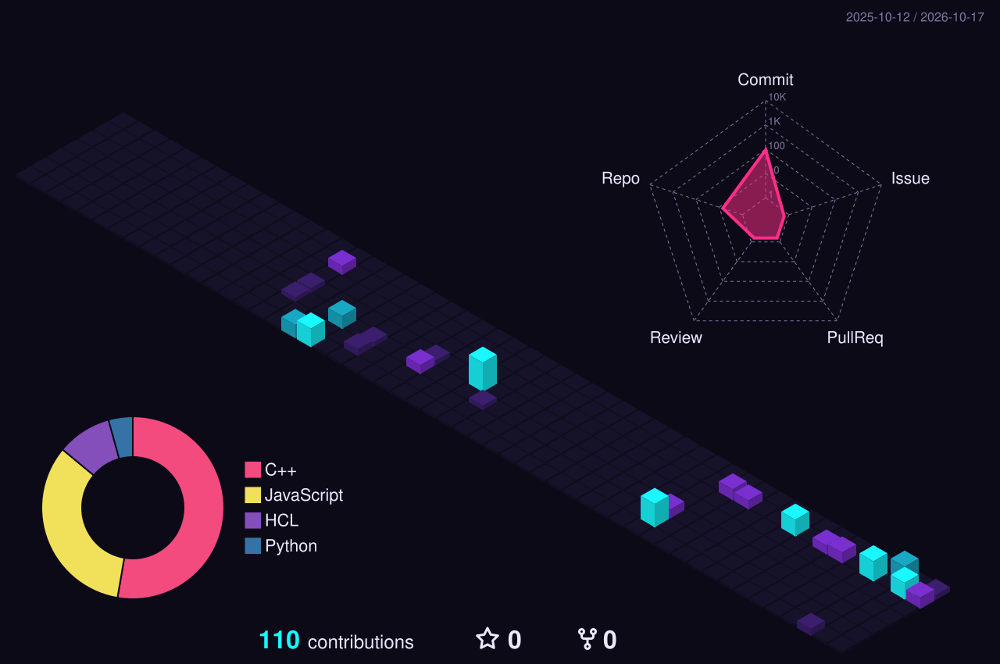
  <picture>
    <source media="(prefers-color-scheme: dark)" srcset="assets/generated/snake-dark.svg">
    <source media="(prefers-color-scheme: light)" srcset="assets/generated/snake-light.svg">
    
  </picture>

  

